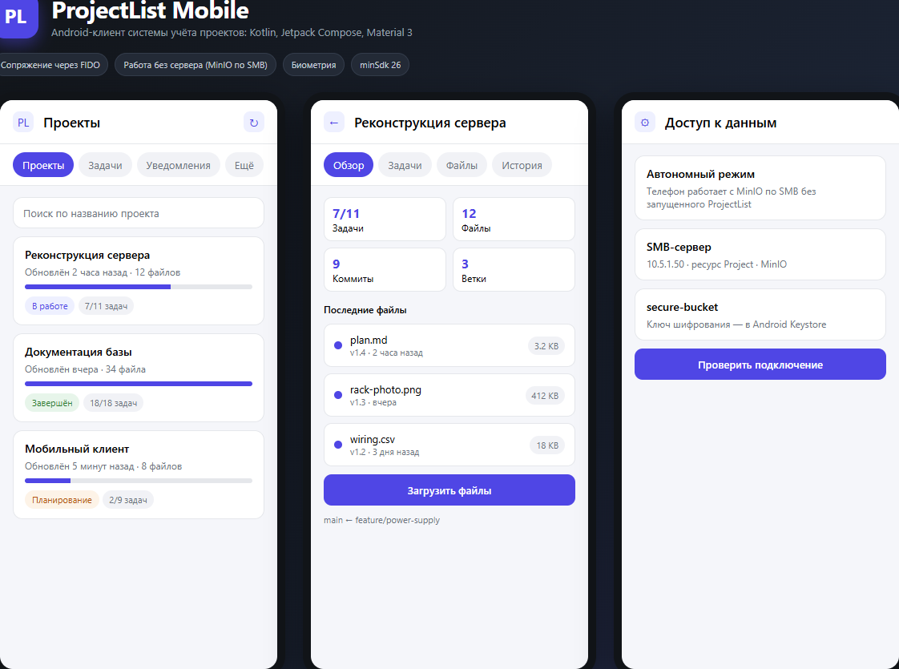
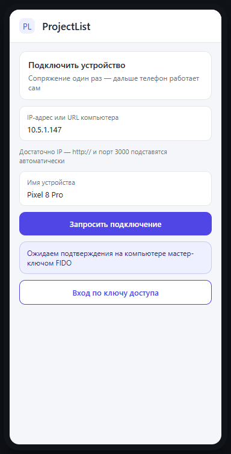
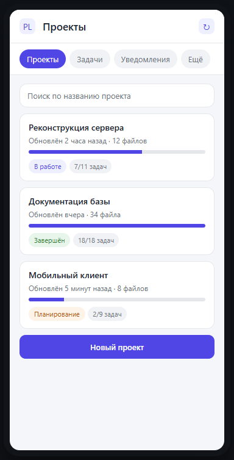
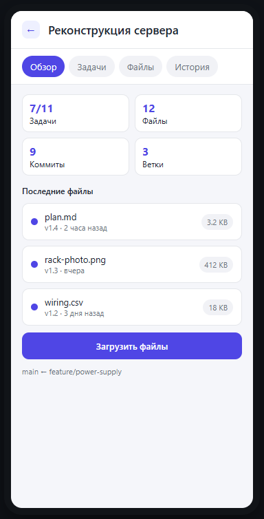
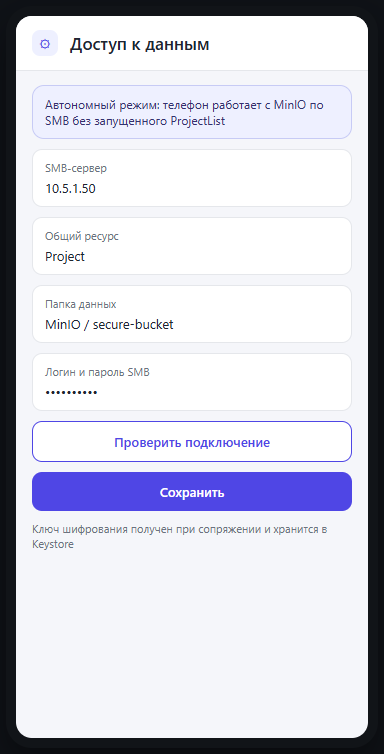

# ProjectList Mobile

<p align="center">
  
</p>

<p align="center">
  
  
  
  
</p>

Нативный Android-клиент для серверного приложения **ProjectList**. Написан на Kotlin
и Jetpack Compose (Material 3), работает с тем же HTTP API, что и веб-интерфейс.

Новое устройство подключается через LAN-сопряжение: запрос подтверждается на компьютере
мастер-ключом FIDO, полученный ключ шифрования (DEK) сохраняется в Android Keystore.
После этого телефон читает и изменяет данные MinIO напрямую по SMB — **без запущенного
ProjectList**: проекты, задачи, файлы, коммиты, ветки, скриншоты, уведомления и журнал
сервера.

---

## One-button сборка

```powershell
.\build.ps1
```

Или двойной клик по **`build.bat`**. Скрипт сам находит JDK и Android SDK, собирает APK
и показывает путь к нему.

| Команда | Что делает |
|---|---|
| `.\build.ps1` | собирает debug APK |
| `.\build.ps1 -Install` | собирает и ставит APK на подключённый телефон (`adb install -r`) |
| `.\build.ps1 -Task assembleRelease` | release-сборка |
| `.\build.ps1 -Clean` | `gradle clean` перед сборкой |
| `.\build.ps1 -Doctor` | показывает найденный JDK и Android SDK, ничего не собирает |

Готовый APK: `app\build\outputs\apk\debug\app-debug.apk` (~24 МБ).

<details>
<summary>Ручная сборка (без скрипта)</summary>

```powershell
$env:JAVA_HOME='C:\Program Files\Java\jdk-21'
.\gradlew.bat assembleDebug
```

</details>

## Скриншоты

> Макеты экранов — схематичные, сделаны по реальной разметке приложения
> (те же цвета, разделы и кнопки). Чтобы заменить их на настоящие снимки, положите
> файлы с теми же именами в `docs/screenshots/`.

<table>
  <tr>
    <td align="center"><br><sub>Подключение устройства</sub></td>
    <td align="center"><br><sub>Проекты</sub></td>
    <td align="center"><br><sub>Проект: файлы и история</sub></td>
    <td align="center"><br><sub>Автономный режим</sub></td>
  </tr>
</table>

**Что видно на экранах**

- **Сопряжение.** Достаточно IP-адреса компьютера: `http://` и порт `3000` подставляются
  автоматически. Подтверждение мастер-ключом FIDO происходит на компьютере.
- **Проекты.** Поиск, статус, прогресс, счётчики задач, дата последнего изменения.
- **Карточка проекта.** Вкладки `Обзор / Задачи / Файлы / История`, счётчики задач,
  файлов, коммитов и веток, загрузка файлов, список версий.
- **Автономный режим.** SMB-сервер, общий ресурс, папка данных, bucket и ключ шифрования
  из Keystore.
- **Уведомления.** Непрочитанные, отметка «прочитано», удаление, очистка.

---

## Возможности

**Вход и сессия**

- Подключение нового устройства через LAN-сопряжение с доверенным АРМ.
- Запрос подтверждается на компьютере мастер-ключом FIDO/WebAuthn, после чего телефон
  получает ключ шифрования (DEK) и сохраняет его в Android Keystore.
- Дальше приложение работает без компьютера: серверная сессия не нужна.
- Дополнительно доступен ручной вход по адресу сервера и ключу доступа
  (`POST /api/auth/unlock`) для работы с запущенным ProjectList.
- Токен сессии, ключ доступа и полученный DEK хранятся в `EncryptedSharedPreferences`.
- Автоматическое восстановление сессии сохранённым ключом при истечении токена.
- «Забыть устройство» удаляет сопряжение и ключ шифрования с телефона.

**Биометрическая защита**

- После холодного старта приложение блокируется и просит подтвердить личность
  отпечатком пальца; без этого проекты и сохранённый ключ недоступны.
- Удаление проекта, задачи, файла, скриншота и действие «Забыть устройство»
  подтверждаются отпечатком.
- Если отпечаток на устройстве не настроен, блокировка снимается кнопкой
  «Открыть приложение», а удаление выполняется после обычного диалога.

**Проекты**

- Список с поиском, прогрессом, статусом и счётчиками.
- Создание, редактирование, удаление проекта.
- Смена статуса: планирование / в работе / по плану / завершён.
- Кэш последнего ответа сервера на случай недоступности сети.

**Задачи**

- Общий список задач по всем проектам с отметкой выполнения.
- Добавление/удаление задач внутри проекта.

**Файлы и версии**

- Загрузка нескольких файлов с коммитом (сообщение, версия).
- Потоковая отправка: файлы читаются и отправляются по одному, память не растёт
  с количеством выбранных файлов.
- Автоматическое разбиение на партии (100 файлов / 8 МБ на запрос).
- Просмотр текста, Markdown и изображений прямо в приложении.
- Скачивание через системный диалог сохранения (SAF).
- Удаление файла новым коммитом.
- История коммитов с изменениями и откат к выбранному коммиту.
- Создание ветки, переключение между ветками и слияние ветки в текущую.
- Скриншоты проекта: просмотр и удаление.

**Уведомления и сервер**

- Уведомления с непрочитанными, отметка «прочитано», удаление и очистка.
- Проверка состояния сервера, версия, аптайм, лимиты загрузки.
- Журнал событий сервера.
- Индикатор доступности хранилища (MinIO).

**Автономный режим (без компьютера)**

- Прямой доступ к данным MinIO на SMB-диске: сервер ProjectList не нужен.
- Просмотр, создание, редактирование и удаление проектов и задач.
- Удаление файлов, коммиты, откат, ветки, слияние, работа с версиями.
- Просмотр и скачивание файлов, удаление скриншотов.
- Загрузка новых файлов и добавление скриншотов в автономном режиме намеренно
  недоступны.

---

## Требования

- **JDK 17 или 21** (`build.ps1` выбирает его автоматически из установленных).
- **Android SDK** с платформой 36 (`compileSdk`/`targetSdk` 36, `minSdk` 26).
- Gradle не нужен — используется `gradlew`.

---

## Подключение устройства (основной способ)

Сопряжение выполняется один раз и требует компьютер только на время запроса.
Дальше телефон работает самостоятельно.

1. Запустите ProjectList на компьютере, где уже настроен мастер-ключ FIDO.
2. Убедитесь, что телефон и компьютер в одной локальной сети.
3. На экране входа укажите только IP-адрес компьютера (например, `10.5.1.147`) и имя
   устройства. Приложение само подставит `http://` и порт `3000`. Если ProjectList
   работает по HTTPS или на другом порту, раскройте **Протокол и порт** и выберите
   нужные значения — итоговый адрес будет показан под полем ввода.
4. На компьютере откройте **Настройки → Подключение устройств** и подтвердите запрос
   мастер-ключом FIDO. Окно запроса действует 2 минуты.
5. Телефон получит DEK, зашифрованный одноразовым ключом, расшифрует его и сохранит
   в Android Keystore. Сразу после этого приложение предложит указать логин и пароль
   SMB для доступа к данным MinIO.
6. После сохранения настроек появится кнопка **Войти без компьютера**.

Запросы на сопряжение принимаются только из локальной сети и только из той же подсети,
что и доверенный АРМ. Ключ передаётся один раз и не пишется в MinIO.

> Если запрос не появляется на компьютере и в логах ProjectList ничего нет, проверьте
> Windows Firewall: входящие подключения к ProjectList должны быть разрешены из локальной
> сети (по умолчанию порт `3000`). Профиль сети на компьютере не должен блокировать
> входящие. Скрипт для добавления правила: `tools/allow-projectlist-firewall.ps1`
> (запускать от имени администратора).
>
> Быстрый запуск: правой кнопкой по `tools/allow-projectlist-firewall.bat` →
> **Запуск от имени администратора** и подтвердите UAC. Для нестандартного порта:
>
> ```powershell
> powershell -ExecutionPolicy Bypass -File .\tools\allow-projectlist-firewall.ps1 -Port 8443
> ```
>
> Правило разрешает входящие только из локальной подсети, а не из интернета.

### Вход по ключу доступа (если ProjectList запущен)

Если нужно работать через HTTP API, раскройте **У меня уже есть ключ доступа** и укажите
адрес сервера и ключ из **Настройки → Ключи доступа**. Этот способ требует запущенного
ProjectList и не нужен для автономной работы.

Сервер работает по HTTP, поэтому в манифесте разрешён cleartext-трафик. Если сервер за
HTTPS — выберите **HTTPS** в разделе **Протокол и порт** или укажите `https://…` прямо
в адресе. Порт по умолчанию — `3000`.

---

## Автономный режим

Телефон работает с данными ProjectList без компьютера: приложение обращается к файлам
MinIO напрямую по SMB и само разбирает формат `xl.meta` и `part.N`. Это позволяет менять
проекты, задачи, файлы и историю, даже когда ProjectList и MinIO остановлены.

Настройка:

1. Пройдите сопряжение устройства (см. выше) — ключ шифрования подставится
   автоматически из Android Keystore.
2. Укажите SMB-сервер (например, `10.5.1.50`), общий ресурс (`Project`), папку данных
   (`MinIO`), логин и пароль SMB.
3. Проверьте bucket (`secure-bucket`). Ключ шифрования ProjectList уже получен при
   сопряжении; при ручной настройке его можно ввести в base64 или hex.
4. Нажмите **Проверить подключение**, затем **Сохранить**.
5. На экране входа появится кнопка **Войти без компьютера**.

Важно:

- **Перед записью остановите ProjectList и MinIO на компьютере.** Иначе их кэш может
  перезаписать изменения, сделанные с телефона. Чтение безопасно в любом случае.
- Пароль SMB и ключ шифрования хранятся в `EncryptedSharedPreferences`, защищённом
  ключом Android Keystore.
- Явный выход из аккаунта отключает автономный режим, но сопряжение и настройки SMB
  сохраняются — войти снова можно без нового запроса.
- «Забыть устройство» в настройках удаляет ключ шифрования с телефона; для дальнейшей
  работы потребуется новое подтверждение мастер-ключом FIDO.
- Загрузка новых файлов и скриншотов в автономном режиме недоступна; удаление файлов,
  коммиты, ветки, слияние и откат работают.

---

## Структура

```
app/src/main/java/com/projectlist/mobile/
├── PLApp.kt                 контейнер зависимостей
├── MainActivity.kt
├── data/
│   ├── ApiClient.kt         HTTP, авторизация, повторный вход
│   ├── PairingClient.kt     LAN-сопряжение и получение DEK через FIDO-одобрение
│   ├── ServerAddress.kt     разбор IP/URL, протокол и порт по умолчанию
│   ├── Repository.kt        кэш, партии загрузки, UploadSession
│   ├── Models.kt            модели ответов API
│   ├── SessionStore.kt      защищённое хранение сессии и настроек SMB
│   ├── Errors.kt            человекочитаемые ошибки
│   └── offline/
│       ├── OfflineStore.kt  проекты, коммиты, ветки, merge, блобы
│       ├── MinioDiskStore.kt доступ к объектам MinIO на диске
│       ├── XlMeta.kt        формат xl.meta и bitrot
│       ├── CryptoBox.kt     AES-GCM записей и блобов
│       ├── MsgPack.kt       разбор/сборка msgpack
│       ├── Hashing.kt       xxHash64, HighwayHash, sha256
│       ├── DiskFs.kt        интерфейс файловой системы
│       ├── SmbDiskFs.kt     SMB-подключение и файловые операции
│       └── OfflineConfig.kt настройки автономного доступа
├── security/
│   └── BiometricAuth.kt     BiometricPrompt и подтверждение действий
└── ui/
    ├── AppRoot.kt           навигация login → home → project
    ├── AppLockViewModel.kt  блокировка в пределах процесса
    ├── AppUnlockScreen.kt   запрос отпечатка после холодного старта
    ├── HomeScreen.kt        вкладки и общие диалоги
    ├── OfflineSetupDialog.kt настройка SMB и ключа
    ├── ProjectsScreen.kt
    ├── TasksScreen.kt
    ├── NotificationsScreen.kt
    ├── SettingsScreen.kt
    ├── ProjectDetailScreen.kt
    ├── *ViewModel.kt
    └── components/          карточки, Markdown, изображения
```

## Ограничения

Клиент намеренно покрывает основные сценарии. В нём нет редактирования зависимостей и
релизов проекта, управления ключами доступа, инструментов шифрования и других серверных
функций, доступных только в веб-интерфейсе.
